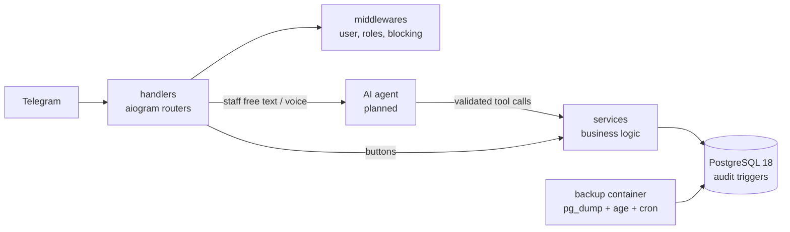

# Nargiza Brend — Shop Assistant Bot

A Telegram bot that replaces the paper debt notebook of a small family-run women's clothing shop
in a Tashkent bazaar. It keeps the debt ledger, sales and stock, talks to customers, and — in later
stages — lets the family run the shop by simply **speaking** to it in Uzbek.

> **Status:** Stage 2 (debt ledger via buttons) implemented — customers, debts, payments, write-offs,
> cancellations, notifications. The AI agent (text, then voice) is next. See the [roadmap](#roadmap).

---

## Why

| Problem | What the bot does |
|---|---|
| Debts live in a paper notebook — it gets lost, smudged, and can't be checked from home | Every debt and payment is a database record with a full audit trail and daily encrypted backups |
| Calling every debtor one by one takes hours | Customers get polite, automatic due-date reminders in Telegram |
| Nobody knows today's sales or what's left in stock | Daily 20:00 report, per-section totals, stock by category |
| The family isn't technical | Staff will simply say *"Umida 100 ming berdi"* ("Umida paid 100k") — an AI agent turns it into a confirmed record |

## Features

**Done (Stage 0–1)**
- Customer registration with **verified phone ownership** (Telegram contact must belong to the sender).
- Phone-based roles: admin from config, staff added by the admin by phone number, everyone else is a customer.
- Admin panel: add / block / remove staff, statistics, shop photo and map location.
- Customer menu: my debt, announcements, about the shop, contact, ads opt-out.
- Confirmation cards for every write — idempotent (double taps write once), expire after 30 minutes.
- Uzbek-aware utilities: Cyrillic ↔ Latin search, phone normalization, amounts in words
  (*"uch yuz ellik ming"* = 350 000), periods (*"o'tgan oy"* = last month).

**Planned** — debt ledger with FIFO payments, sales and stock, returns/exchanges, reports and Excel export,
reminders and broadcasts, AI agent (text, then voice) via Gemini, import of the old paper notebook.

## Data safety

Losing a debt record means the family loses money, so safety is built into every layer:

- **Money is integer so'm** (`BIGINT`), never floats. Balances are computed from records, never stored.
- **Nothing is ever deleted** — soft deletes only; `DELETE` is blocked by database triggers.
- **Tamper-evident audit log** — a Postgres trigger records every insert/update/soft-delete with the actor;
  writes without an actor are rejected; the log itself is immutable.
- **Least-privilege DB role** — the bot cannot delete rows, disable triggers or touch the audit log.
- **Encrypted backups** — `pg_dump | age` (no plaintext ever on disk), hourly/daily/weekly/monthly retention,
  daily copy to the admin's Telegram. Restore is tested, including recovery onto a brand-new server.

Details: [docs/DATA_SAFETY.md](docs/DATA_SAFETY.md) · Disaster recovery: [docs/RUNBOOK.md](docs/RUNBOOK.md)

## Architecture



`services/` knows nothing about Telegram or AI — all business rules are plain, fully tested Python.
More: [docs/ARCHITECTURE.md](docs/ARCHITECTURE.md)

## Tech stack

Python 3.14 · aiogram 3.31 · SQLAlchemy 2.1 (async) + asyncpg · PostgreSQL 18 · Alembic ·
pydantic-settings · structlog · pytest + testcontainers · ruff · mypy (strict) · Docker Compose ·
age (backup encryption) · Gemini API (planned)

## Quick start (development)

```bash
git clone git@github.com:faxriddinswe/Nargiza-Brend-Shop-AI-agent-Bot.git
cd Nargiza-Brend-Shop-AI-agent-Bot

cp .env.example .env          # fill in values — see docs/SETUP_KEYS.md
python3 -m venv .venv
.venv/bin/pip install -e ".[dev]"
.venv/bin/pre-commit install

docker compose up -d postgres
docker compose run --rm bot alembic upgrade head
docker compose up -d --build  # bot + postgres + backup
```

## Quality checks

```bash
.venv/bin/ruff check . && .venv/bin/ruff format --check .
.venv/bin/mypy bot tests
.venv/bin/pytest              # unit + integration (needs Docker for a real Postgres)
```

Every stage ends with automated business-logic and security reviews (`.claude/agents/`).

## Project layout

```
bot/
  handlers/     Telegram routers (common, customer, staff, admin)
  services/     business logic — no Telegram, no AI
  db/           models and unit-of-work session
  utils/        phone, translit, money, dates
  texts/        every user-facing string (Uzbek, Latin script)
migrations/     Alembic (schema, triggers, roles, seed data)
scripts/        backup.sh, restore.sh, restore_test.sh
tests/          unit/ and integration/ (real Postgres via testcontainers)
docs/           design, rules, operations
```

## Documentation

| Document | Contents |
|---|---|
| [BUSINESS_RULES.md](docs/BUSINESS_RULES.md) | Numbered business rules (`BR-xxx`) and open questions |
| [ARCHITECTURE.md](docs/ARCHITECTURE.md) | Components, flows, decisions |
| [DATA_MODEL.md](docs/DATA_MODEL.md) | Tables and constraints |
| [DATA_SAFETY.md](docs/DATA_SAFETY.md) | Transactions, audit, backups |
| [AI_AGENT.md](docs/AI_AGENT.md) | AI agent design and evaluation |
| [SETUP_KEYS.md](docs/SETUP_KEYS.md) | Getting the bot token, keys and accounts |
| [DEPLOY.md](docs/DEPLOY.md) | Environments and deployment |
| [RUNBOOK.md](docs/RUNBOOK.md) | Emergencies: restore, lost keys, lost phones |
| [ADMIN_GUIDE.md](docs/ADMIN_GUIDE.md) | Admin panel |
| [USER_GUIDE_STAFF.md](docs/USER_GUIDE_STAFF.md) | Guide for the family (in Uzbek) |
| [CHANGELOG.md](docs/CHANGELOG.md) | History |

The original requirements (in Uzbek) are in [NARGIZA_BREND_MASTER_PROMPT.md](NARGIZA_BREND_MASTER_PROMPT.md).

## Roadmap

| Stage | Scope | Status |
|---|---|---|
| 0 | Skeleton, tooling, CI, business rules | ✅ |
| 1 | Database, audit, registration, roles, admin panel, encrypted backups | ✅ |
| 2 | Debt ledger and customers (buttons): debts, FIFO payments, write-offs, cancel | ✅ (pending owner acceptance) |
| 3 | AI agent (text) — Gemini tool calling, evaluation set | ⏳ next |
| 4 | Voice messages | |
| 5 | Sales, stock, returns and exchanges | |
| 6 | Reports and Excel export | |
| 7 | Reminders and broadcasts | |
| 8 | Import of the old paper notebook | |
| 9 | Integrity checks, monitoring | |
| 10 | Deployment (staging → production) | |
| 11 | Family onboarding, 2-week parallel run with the notebook | |

## Privacy

This repository is public. It contains **no secrets and no customer data**: tokens and passwords live
only in `.env` (git-ignored), and development uses fake data only. Family members appear in the docs under
pseudonyms. Customer data is processed only in production, with consent collected at registration.

Found a security issue? See [SECURITY.md](SECURITY.md).
