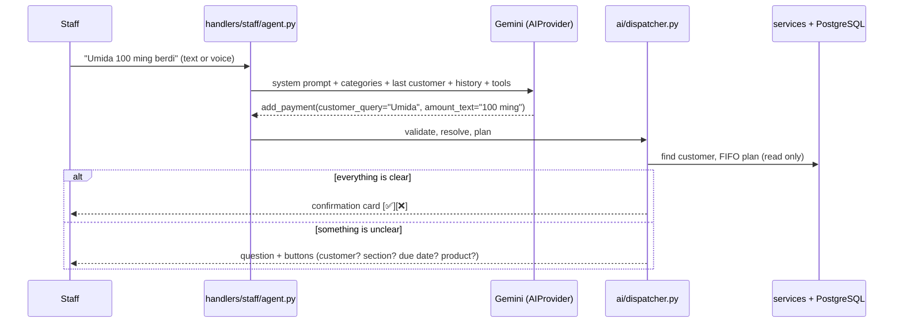

# AI agent

Staff talk to the bot in free text or **voice messages** (Uzbek, Latin or Cyrillic). The model figures out
what they want; our code does everything else. Customers never reach the AI (buttons only).

## How a message is handled

## Rules (master §8.4) and how the code enforces them

| Rule | Enforcement |
|---|---|
| The AI never calculates | Numbers are passed as spoken (`amount_text`, `unit_price_text`, `due_text`, `phone_text`) and parsed by `utils/money.py` / `utils/dates.py`. FIFO, balances and differences come from `services/`. |
| The AI never decides permissions | `dispatcher.run_call` checks the role in code; every service re-checks it. |
| The AI never guesses | Unclear customer, product, section, debt, amount, due date → a question (`ask` tool or dispatcher-generated choices). Ambiguous amounts (`1500`, `350-400 ming`, `1.500 mln`) are asked again. |
| The AI never picks ids | Customers are found by code from the words. Ids, sections and debts chosen on buttons live in a server-side `ToolCall.fix`; an `_fix` key in the model's output is ignored. Buttons carry a nonce, so an older question's buttons are refused. |
| A wrong customer is worse than a question | A name is accepted silently only if every spoken word is a whole word of exactly one customer's name (or the digits end exactly one phone). A lone fuzzy hit ("Umid" → "Umida") is confirmed with ✅/❌ first. |
| "350" is never silent | A unit-less amount (BR-076) is read as 350 000 and a ⚠️ line above the card says so. Ambiguous ones (`1500`, `350-400 ming`) are asked again. |
| Context is short-lived | The last customer and the last 3 exchanges are forgotten after 15 minutes (BR-111). |
| Budget protection | Per staff member: 10 requests/minute and 300/day (from `ai_calls`), 4 model calls at once, text cut at 1000 characters, `max_output_tokens=1024`. |
| Errors never leak text | Logs contain exception type and code location only (`safe_frames`), never the message. |
| Nothing is saved without confirmation | Writes only create a `pending_actions` card; the ✅ runs the action (same path as the button flows). |
| Section is decided in code | Product → category → section via the synonyms table; the model's words are only input. |
| Logging without personal data | `ai_calls` stores tokens, latency, estimated cost, tool names — never text or audio. |
| AI down → staff keep working | Friendly message, buttons stay, admins get one alert per 10 minutes. |

## Provider abstraction

`ai/base.py` defines `AIProvider.decide(system, text, audio, history, tools) -> AIResult`.
`ai/gemini.py` implements it with `google-genai` (`client.aio.models.generate_content`,
`types.Part.from_bytes(..., mime_type="audio/ogg")`, function calling forced with
`FunctionCallingConfigMode.ANY`, automatic calling disabled). The model name comes from `GEMINI_MODEL`
(never hard-coded). Another provider (Claude + separate speech-to-text) can be added as `ai/claude.py`
and selected with `AI_PROVIDER`.

## Tools

| Tool | Kind | Meaning |
|---|---|---|
| `add_debt` | write | Debt for a customer (items: product, quantity, unit price; optional due date) |
| `add_payment` | write | Customer paid; optional section or a specific debt ("oyoq kiyim qarzidan") |
| `write_off` | write | Forgive a debt (partial or `all`) |
| `create_customer` / `delete_customer` | write | Customer management |
| `cancel_last_entry` | write | Cancel the latest record — with no name, the caller's own latest; the card shows who wrote it and when |
| `add_sale` | write | Cash or mixed sale (optional agreed total = discount, `paid_text` = cash now, rest on credit) |
| `add_stock_in`, `stock_count` | write | Stock-in; inventory count / opening stock (stored as adjustments) |
| `register_return` | write | Return, or exchange when `new_items` is given; the dispatcher finds the original purchase and asks which one / how many |
| `get_stock`, `list_low_stock` | read | Stock levels; low or negative stock |
| `get_customer_debt`, `search_customer` | read | Answer immediately |
| `list_debtors`, `list_overdue` | read | Debtors by size; overdue debts with days |
| `ask` | — | One short clarifying question |
| `say` | — | Greeting, thanks, or "not built yet" (sales, stock, reports come in later stages) |

## Conversation memory (BR-110 / BR-111)

The last discussed customer and the last 3 exchanges are kept per chat for 15 minutes, so
"unga yana 20 ming" and short answers like "yuz ming" work. Voice messages are transcribed by the model in the
`heard` field, which is what goes into the history.

## Voice

Telegram voice notes (OGG/Opus) are sent to the model as `audio/ogg` bytes — no separate speech-to-text.
Limits: 90 seconds and 2 MB per message (configurable `VOICE_MAX_SECONDS`). Google documents 32 audio tokens per second.

## Privacy

Real customer data may only be sent with a **paid-tier** key. On the free tier Google may use submitted content to
improve its products and human reviewers may read it; the paid tier does not use prompts or responses for that
(see [Gemini API terms](https://ai.google.dev/gemini-api/terms)). Use the free tier only with fake data.

## Evaluation

**First real run (2026-11-11, `gemini-3.5-flash-lite`, free tier, 72 checks): 97.2 % overall, 97.6 % on write tools**
(41/42; requirement ≥ 90 %). The one wrong write was a mis-transcribed name (`Dilnoba` for `Dilnoza`), which the
dispatcher would have confirmed with ✅/❌ before using it. Average ≈ 2.7 k tokens per request (≈ $0.001 at paid rates).
On the free tier a few replies took 30–40 s or failed with a connection error — the eval retries; production should use
the paid tier (higher limits).

`tests/eval/phrases.yaml` — 66 phrases (Latin + Cyrillic, numbers in words, mixed requests, must-ask cases,
unsupported requests). `scripts/run_eval.py` sends them to the real model and compares tools, customers, amounts
(read by our parser), products and due dates. Acceptance: **≥ 90 %** on write tools. Real family voice messages go to
`tests/eval/audio/` (git-ignored).

Automated tests with a fake model (`tests/integration/test_ai_dispatcher.py`, `tests/unit/test_gemini_adapter.py`)
cover the dispatcher rules and the exact request sent to Gemini.
