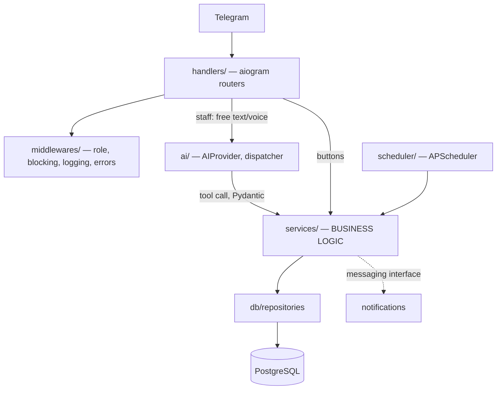

# Architecture

> Status: Stage 1 implemented (handlers, middlewares, services, db, backup container). AI and scheduler parts are planned (Stages 3–7).

## Layers



**Core rule:** `services/` imports neither aiogram nor the AI layer. As a result:
- business logic can be fully tested without Telegram;
- switching the AI provider (Gemini → Claude) does not touch the services;
- the AI only states *what the user wants to do*; calculations and permission checks happen in code.

## Write flow (with confirmation)

```mermaid
sequenceDiagram
    participant X as Staff member
    participant B as Bot (handler)
    participant A as AI
    participant S as Service
    participant D as DB
    X->>B: "Umida 100 ming berdi" (Umida paid 100k)
    B->>A: text + context + tools
    A-->>B: add_payment(customer="Umida", amount=100000)
    B->>S: preview (calculated in code: FIFO allocation)
    S-->>B: confirmation card + idempotency key
    B->>X: card [✅][✏️][❌]
    X->>B: ✅
    B->>S: commit(key)
    S->>D: BEGIN; payment + allocation + audit; COMMIT
    S-->>B: result + who to notify
```

## Bot mode

- **Dev:** long polling.
- **Production:** long polling (initial decision). Rationale: a single server, a single bot instance and a light load (4 staff members, ~500 customers). A webhook would require a domain, a TLS certificate and a publicly exposed HTTPS port, which means extra attack surface and extra configuration. Moving to a webhook will be reconsidered if the load grows.

## Component list

Folder structure: see section 11 of the master prompt.
