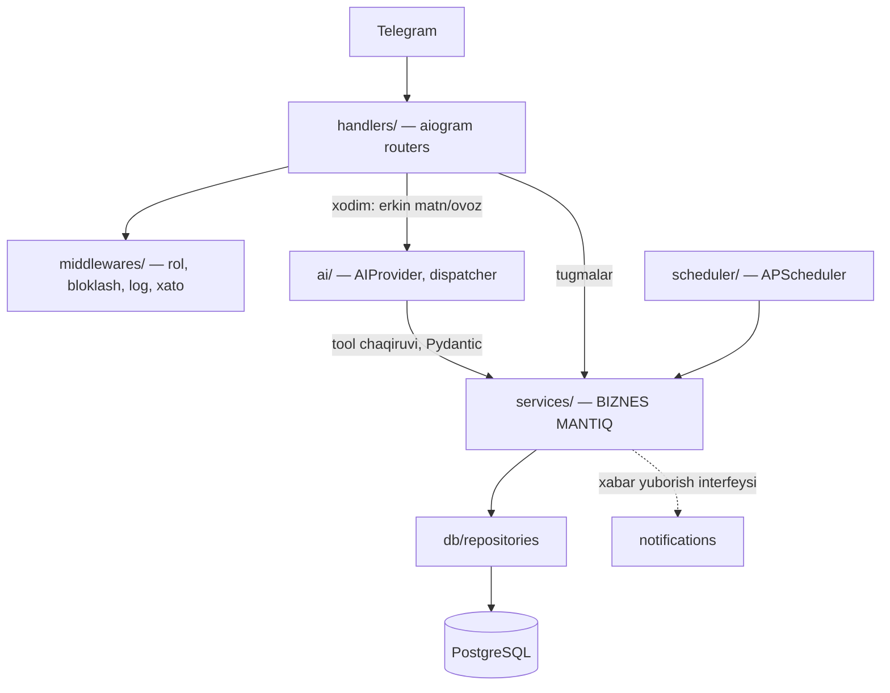

# Arxitektura

> Holat: skelet (0-bosqich). 1–3-bosqichlarda to'ldiriladi, `architect` agenti ko'rib chiqadi.

## Qatlamlar



**Asosiy qoida:** `services/` aiogram'ni ham, AI'ni ham import qilmaydi. Shunda:
- biznes mantiq Telegram'siz to'liq testlanadi;
- AI provayderini (Gemini → Claude) almashtirish service'larga tegmaydi;
- AI faqat "nima qilmoqchi"ni aytadi, hisob-kitob va ruxsat — kodda.

## Yozish oqimi (tasdiq bilan)

```mermaid
sequenceDiagram
    participant X as Xodim
    participant B as Bot (handler)
    participant A as AI
    participant S as Service
    participant D as DB
    X->>B: "Umida 100 ming berdi"
    B->>A: matn + kontekst + tool'lar
    A-->>B: add_payment(customer="Umida", amount=100000)
    B->>S: preview (hisob kodda: FIFO taqsimot)
    S-->>B: tasdiqlash kartasi + idempotency key
    B->>X: karta [✅][✏️][❌]
    X->>B: ✅
    B->>S: commit(key)
    S->>D: BEGIN; to'lov + taqsimot + audit; COMMIT
    S-->>B: natija + kimga xabar
```

## Bot rejimi

- **Dev:** long polling.
- **Production:** long polling (dastlabki qaror). Sabab: bitta server, bitta bot nusxasi, kam yuklama (4 xodim, ~500 mijoz); webhook uchun domen, TLS sertifikat va ochiq HTTPS port kerak — bu qo'shimcha hujum yuzasi va sozlash. Webhook'ga o'tish yuklama oshsa ko'rib chiqiladi.

## Komponentlar ro'yxati

Papka tuzilmasi — master prompt 11-bo'lim.
