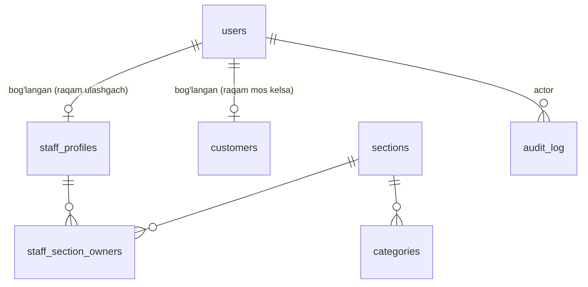

# Ma'lumotlar modeli

> Holat: 1-bosqich jadvallari amalga oshirildi (migratsiya `0001`). Architect tavsiyalari qabul qilindi:
> audit — Postgres trigger; sinonimlar alohida jadval; `pending_actions` → `pending_actions`; telefon CHECK.
> Quyidagi matnning ayrim joylari dastlabki reja — haqiqiy sxema: `bot/db/models.py` va migratsiya.
> 1-bosqichda **poydevor jadvallari** yaratiladi. Qarz/to'lov jadvallari 2-bosqichda, savdo/ombor 5-bosqichda,
> e'lon/eslatma 7-bosqichda — har biri o'z Alembic migratsiyasi bilan, qoidalari tasdiqlangandan keyin.

## Umumiy qoidalar

- Pul: `BIGINT` (so'm), `CHECK (amount > 0)`. Python'da `int`.
- Vaqt: `timestamptz`, server tomonda `now()`; ko'rsatishda `Asia/Tashkent`.
- Soft delete: `deleted_at timestamptz NULL`, `deleted_by → users.id`. `DELETE` ishlatilmaydi.
- Har bir biznes jadvalda: `created_at`, `created_by`, `updated_at`.
- Enum'lar Postgres'da `text + CHECK` sifatida (yangi qiymat qo'shish migratsiyada oson).
- Audit: Postgres `audit_trigger()` (SECURITY DEFINER) har bir insert/update/soft-delete/restore ni yozadi.
  Kim qilgani — tranzaksiya boshida `set_config('app.actor_id'/'app.actor_kind', ..., true)` (`bot/db/session.py: uow`).
  Aktorsiz yozuv rad etiladi. ORM'dan tashqari yo'llar (bulk, psql) ham audit'dan o'tadi.
- DB rollari: egasi (migratsiya, backup) va `nargiza_app` (bot): SELECT/INSERT/UPDATE, DELETE yo'q, audit_log faqat o'qish.

## 1-bosqich jadvallari

### users — Telegram foydalanuvchilari
| Ustun | Tur | Izoh |
|---|---|---|
| id | bigint PK | |
| telegram_id | bigint UNIQUE NOT NULL | |
| role | text CHECK in (admin, staff, customer) | sukut `customer` |
| tg_first_name | text | Telegram'dagi ism (taklif uchun) |
| phone | text NULL UNIQUE | faqat o'zi ulashgan va tekshirilgan kontakt, `+998XXXXXXXXX` |
| is_blocked | bool | admin bloklasa — hech narsa qila olmaydi |
| bot_blocked_at | timestamptz NULL | foydalanuvchi botni bloklagan (yuborishda aniqlanadi) |
| ads_opt_out | bool | reklamani o'chirgan |
| script_pref | text CHECK in (latn, cyrl) | sukut `latn` |
| consent_at | timestamptz NULL | rozilik matnini ko'rgan vaqt |
| created_at, updated_at | timestamptz | |

### staff_profiles — xodimlar (admin raqam bilan qo'shadi)
| Ustun | Tur | Izoh |
|---|---|---|
| id | bigint PK | |
| phone | text NOT NULL | admin kiritgan raqam |
| user_id | FK users NULL UNIQUE | raqamini ulashganda bog'lanadi |
| display_name | text NOT NULL | "Nodira opa" |
| is_active | bool | xodimlikdan olinsa `false` |
| created_by, created_at, updated_at, deleted_at, deleted_by | | |

Partial unique: `phone WHERE deleted_at IS NULL`.
Rol `users.role` da saqlanadi (yagona manba); `staff_profiles` — xodim haqidagi ma'lumot.

### staff_section_owners
`staff_id → staff_profiles`, `section_id → sections`, PK (staff_id, section_id). Bo'lim egasiga xabar (BR-026) uchun.

### sections
`id`, `code` UNIQUE (`shop`, `lingerie`), `name`, `card_number` NULL, `card_holder` NULL. Migratsiyada seed.

### categories — tovar turlari
| Ustun | Tur | Izoh |
|---|---|---|
| id | bigint PK | |
| section_id | FK sections NOT NULL | |
| name | text NOT NULL | "ko'ylak" |
| low_stock_threshold | int NULL CHECK ≥ 0 | |
| is_active | bool | |

Unique: `lower(name)`, `(id, section_id)` (2-bosqichda kompozit FK uchun). Seed — BUSINESS_RULES 3.1 (pijama, xalat → shop).

### category_synonyms
`id`, `category_id → categories`, `synonym` UNIQUE (`search_key()` ko'rinishida). Bitta so'z faqat bitta turga tegishli.

### customers — mijozlar (daftar)
| Ustun | Tur | Izoh |
|---|---|---|
| id | bigint PK | |
| name | text NOT NULL | "Umida" |
| search_name | text NOT NULL | lotin, kichik harf, apostrof normallashgan (qidiruv uchun) |
| phone | text NULL | `+998XXXXXXXXX` |
| phone_missing | bool GENERATED (`phone IS NULL`) STORED | |
| address_form | text CHECK in (opa, aka) | |
| note | text NULL | "Shahlo opaning qizi" |
| user_id | FK users NULL | ro'yxatdan o'tib bog'langan |
| created_by, created_at, updated_at, deleted_at, deleted_by | | |

Partial unique: `phone WHERE deleted_at IS NULL`; `user_id WHERE deleted_at IS NULL`.
Index: `pg_trgm` GIN `search_name` (fuzzy qidiruv uchun, 2-bosqichda ishlatiladi).

### settings — kalit-qiymat
`key` text PK, `value` jsonb NOT NULL, `updated_by`, `updated_at`. Masalan: `shop.photo_file_id`, `shop.location`,
`schedule.weekly_day_off` (null), `reminders.time`.

### audit_log
| Ustun | Tur |
|---|---|
| id | bigint PK |
| actor_id | FK users NULL (NULL = tizim, masalan scheduler) |
| action | text CHECK in (insert, update, soft_delete, restore) |
| table_name | text |
| actor_kind | text CHECK in (user, system, migration) |
| record_id | text (kompozit kalit `1:2`) |
| old | jsonb NULL |
| new | jsonb NULL |
| at | timestamptz |

Faqat qo'shiladi; ilova DB foydalanuvchisiga `audit_log` uchun UPDATE/DELETE huquqi berilmaydi (9-bosqichda).

### pending_actions
| Ustun | Tur | Izoh |
|---|---|---|
| key | text PK | tasdiqlash kartasi yaratilganda beriladi |
| user_id | FK users | |
| action | text | |
| status | text CHECK in (pending, done) | |
| result | jsonb NULL | natija (takroriy bosishda shu qaytariladi) |
| created_at, completed_at | timestamptz | |

Tasdiq bosilganda: `INSERT ... ON CONFLICT DO NOTHING` + `SELECT ... FOR UPDATE` — ikkinchi bosish birinchisi
tugashini kutadi va tayyor natijani oladi. Hammasi biznes amal bilan **bitta tranzaksiyada**.

## Keyingi bosqichlar (reja)
- 2: `debts`, `debt_items`, `payments` (kind: payment/write_off), `payment_allocations`, `debt_adjustments`.
- 5: `sales`, `sale_items`, `returns`, `stock_movements`.
- 7: `broadcasts`, `broadcast_recipients`, `reminders_log`.
- 3: `ai_calls`.
