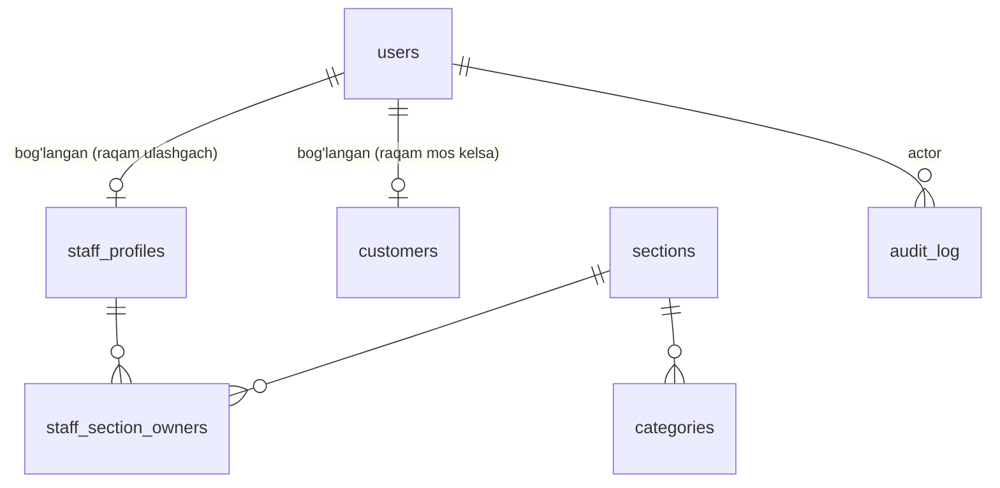
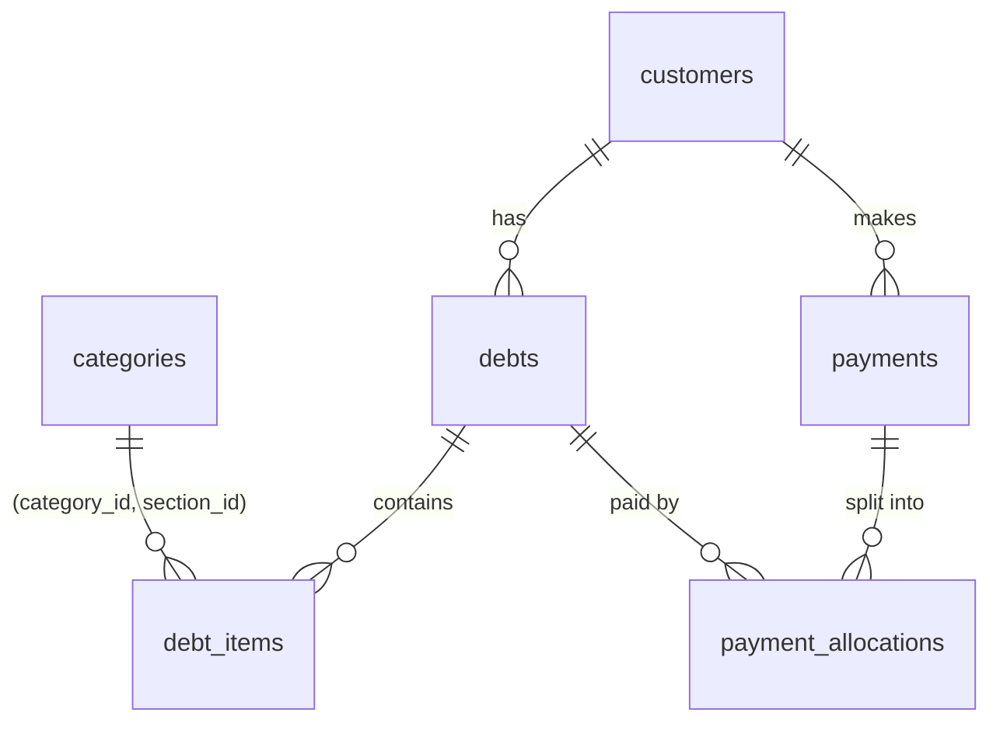
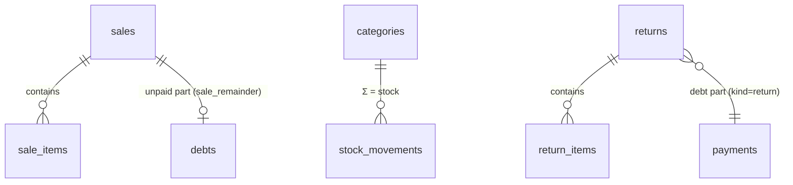

# Data Model

> Status: phase 1 tables implemented (migration `0001`). Architect recommendations adopted:
> audit — Postgres trigger; synonyms in a separate table; `idempotency_keys` renamed to `pending_actions`; phone CHECK.
> Some parts of the text below reflect the initial plan — the actual schema is in `bot/db/models.py` and the migration.
> Phase 1 creates the **foundation tables**. Debt/payment tables come in phase 2, sales/stock in phase 5,
> announcements/reminders in phase 7 — each with its own Alembic migration, after its rules are approved.

## General rules

- Money: `BIGINT` (so'm), `CHECK (amount > 0)`. `int` in Python.
- Time: `timestamptz`, `now()` on the server side; displayed in `Asia/Tashkent`.
- Soft delete: `deleted_at timestamptz NULL`, `deleted_by → users.id`. `DELETE` is never used.
- Every business table has: `created_at`, `created_by`, `updated_at`.
- Enums are implemented in Postgres as `text + CHECK` (makes adding new values in a migration easy).
- Audit: the Postgres `audit_trigger()` (SECURITY DEFINER) records every insert/update/soft-delete/restore.
  The actor is set at the start of the transaction via `set_config('app.actor_id'/'app.actor_kind', ..., true)` (`bot/db/session.py: uow`).
  Writes without an actor are rejected. Paths outside the ORM (bulk, psql) also go through the audit.
- DB roles: owner (migrations, backups) and `nargiza_app` (the bot): SELECT/INSERT/UPDATE, no DELETE, read-only on audit_log.

## Phase 1 tables

*(Diagram labels: "bog'langan (raqam ulashgach)" = linked (once the number is shared); "bog'langan (raqam mos kelsa)" = linked (if the number matches).)*

### users — Telegram users
| Column | Type | Note |
|---|---|---|
| id | bigint PK | |
| telegram_id | bigint UNIQUE NOT NULL | |
| role | text CHECK in (admin, staff, customer) | default `customer` |
| tg_first_name | text | Name in Telegram (used as a suggestion) |
| phone | text NULL UNIQUE | only a contact the user shared themselves and that was verified, `+998XXXXXXXXX` |
| is_blocked | bool | if blocked by the admin — cannot do anything |
| bot_blocked_at | timestamptz NULL | the user has blocked the bot (detected when sending) |
| ads_opt_out | bool | has turned off promotions |
| script_pref | text CHECK in (latn, cyrl) | default `latn` |
| consent_at | timestamptz NULL | when the consent text was shown |
| created_at, updated_at | timestamptz | |

### staff_profiles — staff (added by the admin via phone number)
| Column | Type | Note |
|---|---|---|
| id | bigint PK | |
| phone | text NOT NULL | number entered by the admin |
| user_id | FK users NULL UNIQUE | linked when they share their number |
| display_name | text NOT NULL | "Nodira opa" |
| is_active | bool | `false` when removed from staff |
| created_by, created_at, updated_at, deleted_at, deleted_by | | |

Partial unique: `phone WHERE deleted_at IS NULL`.
The role is stored in `users.role` (single source of truth); `staff_profiles` holds information about the staff member.

### staff_section_owners
`staff_id → staff_profiles`, `section_id → sections`, PK (staff_id, section_id). Used for section-owner notifications (BR-026).

### sections
`id`, `code` UNIQUE (`shop`, `lingerie`), `name`, `card_number` NULL, `card_holder` NULL. Seeded in the migration.

### categories — product categories
| Column | Type | Note |
|---|---|---|
| id | bigint PK | |
| section_id | FK sections NOT NULL | |
| name | text NOT NULL | "ko'ylak" (dress) |
| low_stock_threshold | int NULL CHECK ≥ 0 | |
| is_active | bool | |

Unique: `lower(name)`, `(id, section_id)` (for a composite FK in phase 2). Seed — BUSINESS_RULES 3.1 (pijama, xalat → shop).

### category_synonyms
`id`, `category_id → categories`, `synonym` UNIQUE (in `search_key()` form). A given word belongs to only one category.

### customers — customers (the notebook)
| Column | Type | Note |
|---|---|---|
| id | bigint PK | |
| name | text NOT NULL | "Umida" |
| search_name | text NOT NULL | Latin script, lowercase, apostrophes normalised (for search) |
| phone | text NULL | `+998XXXXXXXXX` |
| phone_missing | bool GENERATED (`phone IS NULL`) STORED | |
| address_form | text CHECK in (opa, aka) | |
| note | text NULL | "Shahlo opaning qizi" (*"Shahlo opa's daughter"*) |
| user_id | FK users NULL | linked after registration |
| created_by, created_at, updated_at, deleted_at, deleted_by | | |

Partial unique: `phone WHERE deleted_at IS NULL`; `user_id WHERE deleted_at IS NULL`.
Index: `pg_trgm` GIN on `search_name` (for fuzzy search, used in phase 2).

### settings — key-value
`key` text PK, `value` jsonb NOT NULL, `updated_by`, `updated_at`. Examples: `shop.photo_file_id`, `shop.location`,
`schedule.weekly_day_off` (null), `reminders.time`.

### audit_log
| Column | Type |
|---|---|
| id | bigint PK |
| actor_id | FK users NULL (NULL = system, e.g. the scheduler) |
| action | text CHECK in (insert, update, soft_delete, restore) |
| table_name | text |
| actor_kind | text CHECK in (user, system, migration) |
| record_id | text (composite key `1:2`) |
| old | jsonb NULL |
| new | jsonb NULL |
| at | timestamptz |

Append-only; the application DB user is not granted UPDATE/DELETE on `audit_log` (in phase 9).

### pending_actions
| Column | Type | Note |
|---|---|---|
| key | text PK | assigned when the confirmation card is created |
| user_id | FK users | |
| action | text | |
| status | text CHECK in (pending, done) | |
| result | jsonb NULL | result (returned again on a repeated press) |
| created_at, completed_at | timestamptz | |

On confirmation: `INSERT ... ON CONFLICT DO NOTHING` + `SELECT ... FOR UPDATE` — a second press waits for the first
to finish and receives the ready result. All of this happens in **a single transaction** together with the business action.

## Later phases (plan)
- 2: `debts`, `debt_items`, `payments` (kind: payment/write_off), `payment_allocations`, `debt_adjustments`.
- 5: `sales`, `sale_items`, `returns`, `stock_movements`.
- 7: `broadcasts`, `broadcast_recipients`, `reminders_log`.
- 3: `ai_calls`.

## Stage 2 tables — debt ledger (design, pending architect review)

### debts
| Column | Type | Notes |
|---|---|---|
| id | bigint PK | |
| customer_id | FK customers NOT NULL | |
| section_id | FK sections NOT NULL | UNIQUE (id, section_id) — target of composite FKs |
| debt_date | date NOT NULL | business date (Tashkent); FIFO order key (BR-061); import keeps the notebook date |
| due_date | date NULL | NULL = no due date (BR-052); CHECK due_date >= debt_date |
| total_amount | bigint NOT NULL CHECK > 0 | must equal Σ(quantity × unit_price) when items exist (deferred constraint trigger) |
| source | text CHECK in (manual, import) | |
| note | text NULL | |
| status | text CHECK in (active, cancelled) | "closed" is never stored — derived from the balance |
| cancelled_at, cancelled_by | | set together with status = cancelled (CHECK) |
| created_by, created_at, updated_at | | |

### debt_items
`id`, `debt_id`, `section_id`, `category_id`, `quantity int CHECK > 0`, `unit_price bigint CHECK > 0`, `note`.
Composite FKs: `(debt_id, section_id) → debts(id, section_id)` and `(category_id, section_id) → categories(id, section_id)`
— a footwear item can never end up in a lingerie debt (BR-021), enforced by the database.

### payments
| Column | Type | Notes |
|---|---|---|
| id | bigint PK | UNIQUE (id, section_id) |
| customer_id, section_id | FK NOT NULL | a payment belongs to exactly one section (BR-066) |
| kind | text CHECK in (payment, write_off) | cash vs forgiven — never mixed (BR-057) |
| amount | bigint CHECK > 0 | |
| note | text NULL | |
| status | text CHECK in (active, cancelled) | + cancelled_at / cancelled_by |
| created_by, created_at, updated_at | | |

### payment_allocations
`id`, `payment_id`, `debt_id`, `section_id`, `amount bigint CHECK > 0`, UNIQUE (payment_id, debt_id).
Composite FKs to `payments(id, section_id)` and `debts(id, section_id)` — allocations never cross sections.
Deferred constraint triggers (checked at COMMIT):
- Σ allocations of a payment = payment.amount;
- Σ allocations of **active** payments on a debt ≤ debt.total_amount (no overpayment, BR-065);
- the debt and payment belong to the same customer.

### Derived values (never stored)
- debt remaining = total_amount − Σ allocations of active payments (cancelled debts excluded entirely)
- customer balance per section = Σ remaining of active debts
- cancelling a payment frees its allocations; cancelling a debt with active allocations is refused.

## Stage 5 tables — sales, stock, returns (implemented: migrations 0007, 0008)

- **sales**: `items_total − discount_amount = total_amount`; `0 ≤ paid_amount ≤ total_amount`; an unpaid part needs a customer
  (CHECKs). Immutable amounts; status `active → cancelled` only. Unpaid part = `debts` row with `kind='sale_remainder'`,
  `sale_id` set (UNIQUE) and no items.
- **sale_items**: composite FKs keep an item inside its sale's section; deferred trigger checks Σ qty×price = items_total.
- **stock_movements**: append-only ledger (+/−, `reason`: stock_in, sale, debt, return, count_adjustment, cancel).
  Stock = Σ per category; negative is allowed and warned about.
- **returns / return_items**: `value = debt_reduction + cash_refund` (CHECK). The debt part is a `payments` row of
  `kind='return'` (reduces debt like a payment, but is neither cash nor a loss). Returned quantity per source line is derived
  from active returns; the sale discount is spread over lines with the largest-remainder method so refunds never exceed what was paid.
- Cash in = `sales.paid_amount` + `payments(kind='payment')`; cash out = `returns.cash_refund`. `write_off` and `return`
  payments are not cash.
